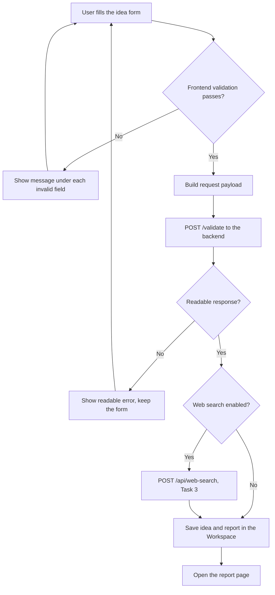
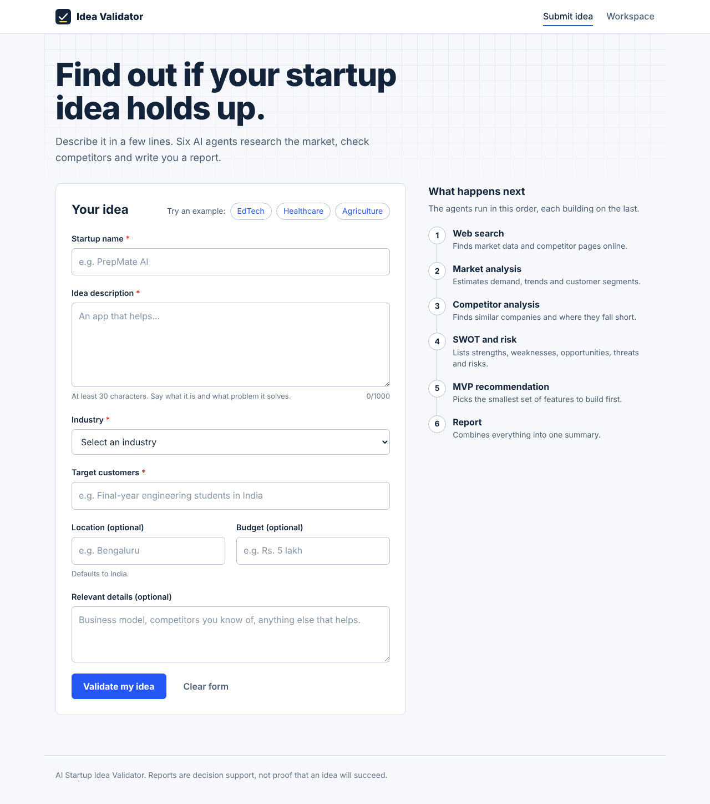
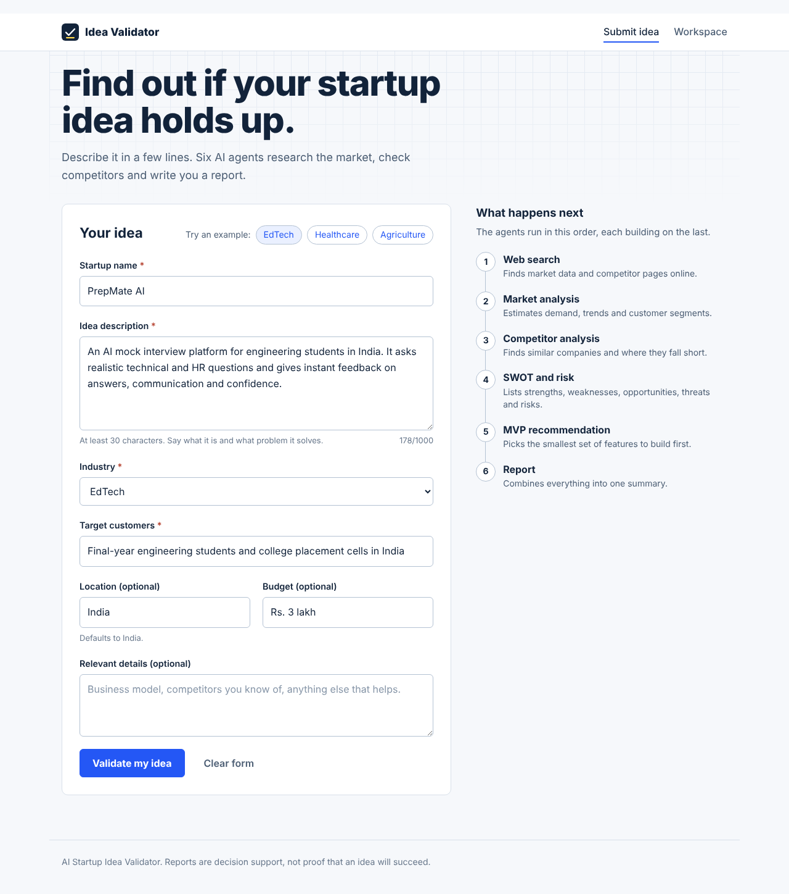
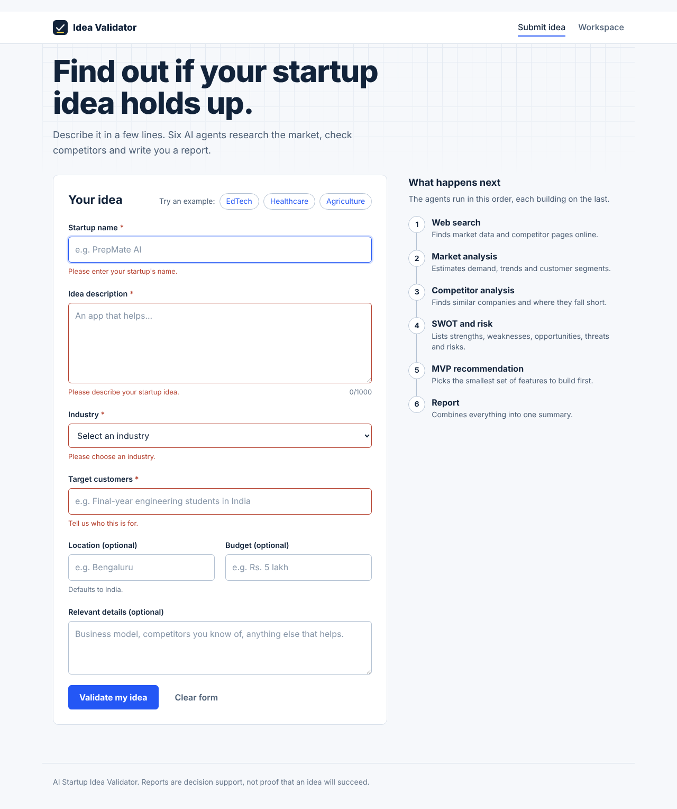
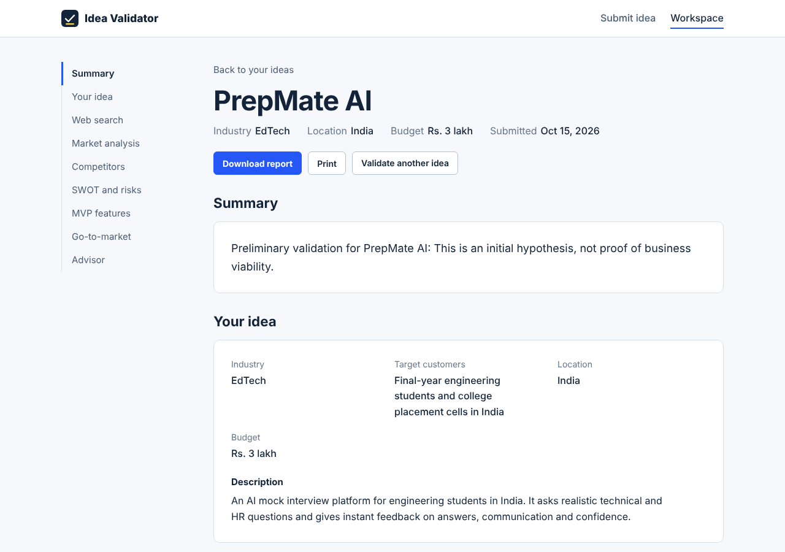
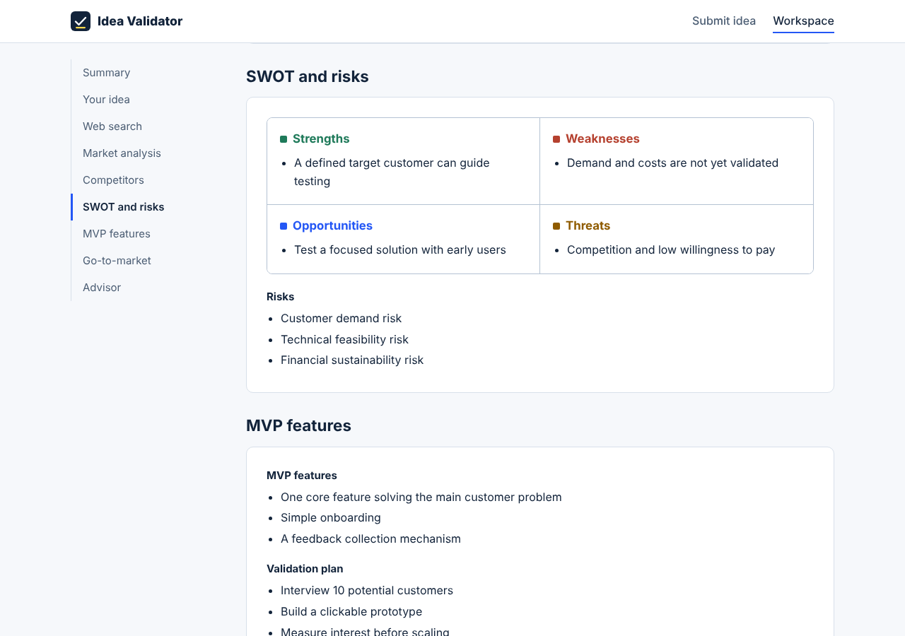

# Startup Idea Submission Interface

## AI-Based Startup Idea Validator with Market Analysis Assistance

**Milestone:** 1, Task 1: Startup Idea Submission Interface
**Document Type:** Technical Implementation Note
**Status:** Implemented and connected to the backend (`POST /validate`)

## 1. Overview

This module is the user-facing entry point of the AI-Based Startup Idea Validator. A founder describes a startup idea in a web form. The form validates the input, sends it to the backend, and shows the report produced by the multi-agent pipeline: market analysis, competitors, SWOT and risks, MVP features, sources and a summary.

The interface is a React single-page application built with Vite, in the `Task-1-Idea-Submission-Interface/` folder of this repository.

## 2. Objective

- Provide a form to submit a startup idea with description, industry, target customers and relevant details.
- Validate the input in the browser so incomplete data is never sent.
- Connect the form to the backend API.
- Show the backend's results in a readable report.
- Optionally show live results from the Web Search Agent (Task 3).
- Handle missing inputs, API failures and unexpected responses with clear messages.
- Keep every backend-specific setting in one file (`src/config.js`).

## 3. Technology Stack

| Technology | Purpose |
|---|---|
| React 18 | User interface |
| Vite 5 | Development server and build tool |
| React Router 6 | Navigation between pages |
| Fetch API | Requests to the backend |
| localStorage | Saves submitted ideas in the browser (Workspace page) |
| Node.js 18+ | Runs the development tools |

## 4. Pages and Features

| Page | Route | What it does |
|---|---|---|
| Submit idea | `/` | The form, three example ideas, and a "what happens next" list of the six agents |
| Report | `/workspace/:id` | Summary, idea details, web search, market analysis, competitors, SWOT matrix, MVP features, with a side menu, Download (.md) and Print |
| Workspace | `/workspace` | List of previously submitted ideas, with delete |

While the backend works, a progress panel lists the six agents in the order they run.

## 5. Form Fields and Validation Rules

| Field | Required | Rules |
|---|---|---|
| Startup name | Yes | 2 to 80 characters |
| Idea description | Yes | 30 to 1000 characters |
| Industry | Yes | Must be chosen from the list |
| Target customers | Yes | 3 to 300 characters |
| Location | No | Up to 100 characters (backend default: India) |
| Budget | No | Up to 100 characters (backend default: Not specified) |
| Relevant details | No | Up to 1000 characters |

Messages appear under each field after the user leaves it or tries to submit. On an invalid submit, focus moves to the first invalid field. The form is disabled while a request is running, which prevents duplicate submissions.

## 6. Workflow



A failure of the optional web search never blocks the report; the report opens with a short note instead.

## 7. API Contract

The frontend matches the backend in `Task-4-Multi-Agent-Architecture`.

**Endpoint:** `POST /validate`

```json
{
  "name": "PrepMate AI",
  "description": "An AI mock interview platform for engineering students.",
  "target_market": "Final-year engineering students in India",
  "industry": "EdTech",
  "location": "India",
  "budget": "Rs. 3 lakh"
}
```

| Form field | Request field |
|---|---|
| Startup name | `name` |
| Idea description (+ relevant details) | `description` |
| Target customers | `target_market` |
| Industry | `industry` |
| Location | `location` (omitted if empty) |
| Budget | `budget` (omitted if empty) |

The backend has no separate field for relevant details, so the frontend appends that text to `description`.

**Response sections:** `startup_idea`, `market_analysis`, `competitor_analysis`, `swot_and_risks`, `mvp_recommendation`, `sources` (title, url, content) and `final_summary`. Unknown extra fields are shown automatically.

**Optional:** `POST /api/web-search` (Task 3) with `{ "startup_idea": "..." }`, returning `generated_queries`, `results`, `failed_queries` and `status`.

## 8. Error Handling

| Situation | Behaviour |
|---|---|
| Required field empty or too short | Message under the field; nothing is sent |
| Backend stopped or unreachable | "Could not reach the server. Check that the backend is running." |
| No reply within 120 seconds | "The server took too long to respond. Please try again." |
| Backend error (422, 500, 502) | The backend's message, or the status code |
| Reply is not JSON, or has no report sections | "The answer was not in the expected format" |
| Web search fails | Report opens; a "Live web search failed" note is shown |
| Placeholder links from the backend's test mode | Flagged as "Sample results" |
| Browser storage blocked | The app keeps working; the Workspace may not save ideas |

After any error the form keeps the user's answers so they can correct and resubmit.

## 9. Project Structure

```text
Task-1-Idea-Submission-Interface/
├── index.html
├── package.json
├── vite.config.js
├── .env.example
├── .gitignore
├── README.md
├── docs/
│   ├── idea-submission-interface.md
│   └── screenshots/
└── src/
    ├── main.jsx, App.jsx, index.css
    ├── config.js              Backend settings (endpoints, payload mapping, report sections)
    ├── samples.js             Three example ideas from different industries
    ├── storage.js             Saves ideas in the browser
    ├── api/                   client.js (requests, timeout, errors), ideaApi.js, mock.js
    ├── utils/                 validation.js, reportMarkdown.js
    ├── components/            IdeaForm, ReportSections, AgentList, AnalyzingPanel,
    │                          AdvisorChat, Markdownish, Layout
    └── pages/                 SubmitIdeaPage, IdeaDetailPage, WorkspacePage
```

## 10. Setup and Execution

### Prerequisites
Node.js 18 or newer, Git, Python 3.10+ (for the backend).

### Frontend
```bash
cd Task-1-Idea-Submission-Interface
npm install
copy .env.example .env        # Mac/Linux: cp .env.example .env
npm run dev
```
Open http://localhost:5173

### Backend (separate terminal)
```bash
cd Task-4-Multi-Agent-Architecture
python -m venv .venv
.venv\Scripts\activate
pip install -r requirements.txt
python -m uvicorn app.main:app --reload
```
The backend starts in mock mode (`USE_MOCKS=true`), so no API keys are needed to test the connection.

### Optional: live web search (Task 3)
```bash
cd Task-3-Web-Search-Agent
pip install -r requirements.txt
python -m uvicorn main:app --reload --port 8001
```
Then set `VITE_ENABLE_WEB_SEARCH=true` in `.env` and restart the frontend.

### Environment variables (`.env`)

| Variable | Default | Purpose |
|---|---|---|
| `VITE_USE_MOCK` | `false` | `true` shows sample data without a backend |
| `VITE_PROXY_TARGET` | `http://localhost:8000` | Main backend address |
| `VITE_ENABLE_WEB_SEARCH` | `false` | Also call the Web Search Agent |
| `VITE_SEARCH_PROXY_TARGET` | `http://localhost:8001` | Web Search Agent address |
| `VITE_API_URL` | empty | Full backend URL for deployed setups |

The frontend holds no API keys. LLM and Tavily keys stay in the backend's `.env`, which must not be committed.

## 11. Testing

### 11.1 Automated browser test
The interface was tested in a real browser (Chromium, driven by an automated script) in two ways: in demo mode, and against a stand-in server that returns the same JSON as the team's `/validate` endpoint and can be switched to fail. **69 of 69 checks passed, with no browser errors.**

| Area | Checks |
|---|---|
| Form validation | Empty submit shows all four required messages; focus moves to the first invalid field; short and over-long descriptions rejected |
| Three industries | EdTech (PrepMate AI), Healthcare (MediRemind) and Agriculture (FarmLink): each fills in, submits, and opens a report with every section |
| Request sent to the backend | Uses the backend's field names; target customers sent as `target_market`; empty optional fields omitted; relevant details appended to the description |
| Report | Opens at the top of the page; shows the backend's data and live search results; flags placeholder links |
| Failures | Backend 502, 422, HTML error page, non-JSON reply, list instead of object, unrelated JSON, server not answering: each shows a clear message and keeps the form; retry works without retyping |
| Web search failing | Report still opens with a "Live web search failed" note |
| Workspace and report | Lists ideas, deletes, downloads a Markdown report, handles an unknown id |
| Phone-size screen | No sideways scrolling on the form or the report |

### 11.2 Manual test with the running backend
The real `/validate` endpoint was called from the backend's `/docs` page and returned **200** with all response sections. Run the three example ideas through the form against the running backend and record the results:

| # | Idea | Industry | Report opened with all sections | Date |
|---|---|---|---|---|
| 1 | PrepMate AI | EdTech | [ ] | |
| 2 | MediRemind | Healthcare | [ ] | |
| 3 | FarmLink | Agriculture | [ ] | |

### 11.3 Screenshots
Taken from the running interface, using a stand-in server that returns the same JSON as the backend in test mode.

| Screenshot | Shows |
|---|---|
|  | The submission form with the six-agent explanation |
|  | The form filled with the EdTech example |
|  | Messages shown for an empty submit |
|  | The report page |
|  | The SWOT section of the report |
|  | The message shown when the backend fails, with the answers kept |

Add your own screenshots from the real backend run (the terminal showing `POST /validate ... 200 OK`, and the report) to `docs/screenshots/`.

## 12. Limitations and Next Steps

- The backend has no advisor chat endpoint and produces no go-to-market section yet. Those parts show a short note and fill in once the backend adds them.
- The structured extraction from Task 2 is not exposed through any API. When the backend returns extra structured fields in `startup_idea`, they are shown under "Structured by the AI".
- With the backend in mock mode, results are placeholder text. Real analysis needs `USE_MOCKS=false` and the LLM and Tavily keys in the backend.
- Ideas are stored in the browser, not in a database.

## 13. Deliverables

- [x] Idea submission form with all required fields
- [x] Input validation with clear messages
- [x] Loading, success and failure states
- [x] Form connected to the backend (`POST /validate`), with optional web search
- [x] Report page for the backend's analysis sections
- [x] Missing input, API failure and unexpected response handling
- [x] Setup instructions, dependencies and environment variables in the README
- [x] Automated test with three ideas from different industries
- [ ] Manual test table in section 11.2 completed
- [x] Screenshots of the interface added
- [ ] Screenshots from the real backend run added

## 14. Conclusion

The interface lets a founder enter a startup idea, validates it before sending, shows progress while the agents run, and presents the multi-agent report in a readable form. All backend-specific settings live in `src/config.js`, so changes to the backend's endpoint or field names need only a small edit.
