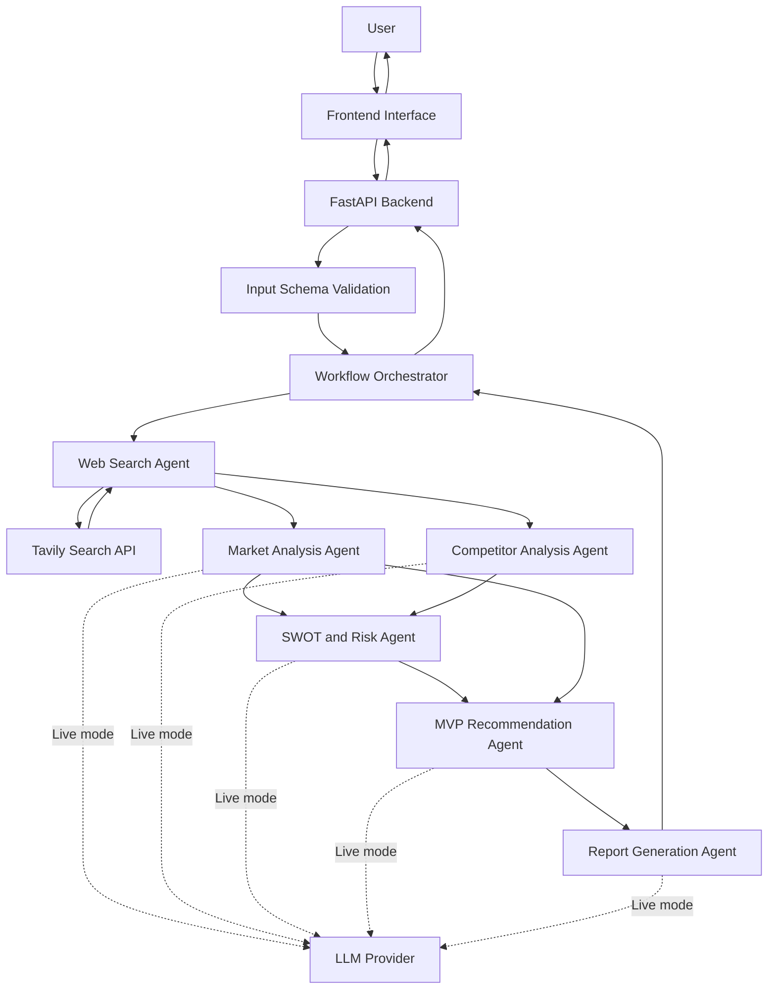

# Multi-Agent Architecture

## Project
AI-Based Startup Idea Validator with Market Analysis Assistance

## Components

1. User Interface: Submits the startup idea and displays the report.
2. FastAPI Backend: Validates requests and exposes the validation endpoint.
3. Orchestrator: Coordinates agents and transfers structured data.
4. Web Search Agent: Collects external research.
5. Market Analysis Agent: Assesses customer needs and opportunities.
6. Competitor Analysis Agent: Examines competitors and alternatives.
7. SWOT and Risk Agent: Identifies strengths, weaknesses, opportunities,
   threats, and major risks.
8. MVP Recommendation Agent: Suggests a small product and validation plan.
9. Report Generation Agent: Produces the final summary.
10. LLM Provider: Supports analysis when live mode is configured.
11. Web Search API: Supplies research when live mode is configured.

## Architecture Diagram

## Data Flow

1. The user submits a startup idea.
2. FastAPI validates the input.
3. The orchestrator calls the web search agent.
4. Search results are passed to market and competitor analysis.
5. Their outputs are passed to the SWOT and risk agent.
6. The findings are passed to the MVP recommendation agent.
7. The report generation agent prepares the summary.
8. The API returns the structured report to the interface.

## Current Implementation

The prototype uses mock data by default. Live LLM and search integrations
are optional and require valid provider credentials.
