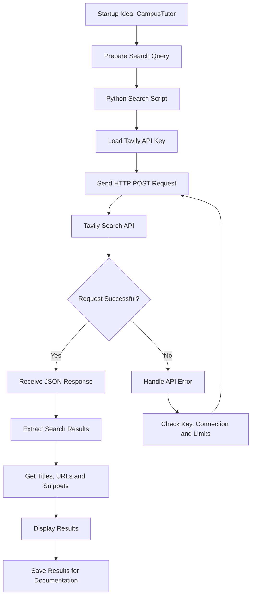

# Web Search API Integration

## AI-Based Startup Idea Validator with Market Analysis Assistance

**Milestone:** 1 — Web Search API Integration  
**Document Type:** Technical Implementation Note  
**Status:** Initial implementation and testing

## 1. Overview

The Web Search API Integration module enables the AI-Based Startup Idea Validator to retrieve relevant online information about startup ideas, market trends, existing businesses, and competitors.

The system uses a web search provider to collect search results containing titles, URLs, and content snippets. These results provide research evidence for the Web Search Agent and support subsequent market and competitor analysis.

Tavily Search API is the proposed provider for this implementation.

## 2. Objective

The objectives of this module are to:

- Understand the purpose of a web search API in an AI-powered application.
- Explore Tavily Search API and its authentication process.
- Submit search queries programmatically using Python.
- Retrieve and display search results in a readable format.
- Provide source URLs for further verification.
- Establish a foundation for integrating web search into the main multi-agent workflow.

## 3. Technology Stack

| Technology | Purpose |
|---|---|
| Python | Implements the API request and result processing |
| Tavily Search API | Retrieves relevant online search results |
| Requests | Sends HTTP requests to the search API |
| Python-dotenv | Loads the API key from a local environment file |
| GitHub | Maintains the source code and documentation |

## 4. Web Search API

A Web Search API allows an application to retrieve online information programmatically instead of requiring users to search manually.

In this project, the API receives a query related to a startup idea and returns relevant web results.

Each result can contain:

- **Title:** The title of the retrieved web page.
- **URL:** The source link for verification.
- **Content:** A text snippet describing relevant information.

### Official Resources

- [Tavily Website](https://tavily.com/)
- [Tavily API Documentation](https://docs.tavily.com/)

## 5. API Integration Workflow

The proposed integration follows these steps:

1. Define a search query based on the startup idea.
2. Load the Tavily API key from an environment variable.
3. Send an HTTP POST request to the Tavily Search API.
4. Receive and parse the JSON response.
5. Extract the titles, URLs, and content snippets.
6. Display the results in a readable format.
7. Preserve source information for subsequent analysis.

## Web Search API Integration Flowchart

This flowchart illustrates how the Web Search API retrieves and displays relevant information for a startup idea.



### Workflow Description

1. **Startup Idea:** The user provides an idea to research.
2. **Query Preparation:** A relevant search query is created.
3. **Python Search Script:** The script prepares the API request.
4. **API Authentication:** The Tavily API key is loaded securely from an environment variable.
5. **HTTP Request:** Python sends the search query to the Tavily Search API.
6. **Response Processing:** The returned JSON response is processed to extract titles, URLs, and content snippets.
7. **Result Display:** The retrieved information is displayed in a readable format.
8. **Error Handling:** Failed requests are handled by checking authentication, connectivity, and usage limits.
9. **Documentation:** Actual search results are recorded as evidence of successful execution.


## 6. Sample Startup Idea

The following startup idea is used to demonstrate the search integration.

**Startup Name:** CampusTutor

**Industry:** Education Technology (EdTech)

**Description:** A platform that connects college students seeking academic assistance with affordable tutors.

**Sample Search Query:**

`online tutoring platforms in India and college student tutoring services`

The search query is intended to retrieve information about existing tutoring services, potential competitors, and relevant educational resources.

## 7. Project Structure

The standalone API test can be organized as follows:

```text
web_search_api/
├── tavily_test.py
├── .env
├── .gitignore
├── requirements.txt
└── README.md
```

- `tavily_test.py` — Sends the search request and displays the returned results.
- `.env` — Stores the local API key.
- `.gitignore` — Prevents sensitive files and local environments from being committed.
- `requirements.txt` — Lists the required Python dependencies.
- `README.md` — Documents the setup, execution, and test results.

## 8. Setup and Configuration

### Prerequisites

- Python 3
- Internet connectivity
- A Tavily account and API key
- A terminal or Python development environment

### Install Dependencies

```bash
pip install requests python-dotenv
```

### Configure the API Key

Create a local `.env` file containing:

```text
TAVILY_API_KEY=your_actual_api_key
```

Replace the placeholder with the API key obtained from the Tavily dashboard.

The API key must remain private and must not be committed to GitHub.

Adding the following entries to `.gitignore`:

```text
.env
.venv/
__pycache__/
```

## 9. Sample Python Implementation

The following script demonstrates how to submit a search request and display the returned results.

```python
import os
import requests
from dotenv import load_dotenv

load_dotenv()

api_key = os.getenv("TAVILY_API_KEY")

if not api_key:
    raise ValueError(
        "TAVILY_API_KEY is missing. Check your .env file."
    )

url = "https://api.tavily.com/search"

payload = {
    "query": (
        "online tutoring platforms in India "
        "and college student tutoring services"
    ),
    "topic": "general",
    "search_depth": "basic",
    "max_results": 5
}

headers = {
    "Authorization": f"Bearer {api_key}",
    "Content-Type": "application/json"
}

try:
    response = requests.post(
        url,
        json=payload,
        headers=headers,
        timeout=30
    )

    response.raise_for_status()
    data = response.json()

    results = data.get("results", [])

    print("\nSTARTUP VALIDATOR - SEARCH RESULTS\n")

    if not results:
        print("No search results were returned.")

    for index, result in enumerate(results, start=1):
        print(f"Result {index}")
        print("Title:", result.get("title", "N/A"))
        print("URL:", result.get("url", "N/A"))
        print(
            "Content:",
            result.get("content", "N/A")[:500]
        )
        print("-" * 60)

except requests.RequestException as error:
    print("Search request failed:", error)

    if error.response is not None:
        print("Response:", error.response.text)
```

## 10. Execution

Run the following command from the project directory:

```bash
python tavily_test.py
```

When the API request succeeds, the program displays the search results returned by Tavily.

The output contains the result number, title, source URL, and content snippet.

## 11. Sample Output Format

The following illustrates the expected output structure. Actual titles, URLs, and snippets must be obtained by executing the script.

```text
STARTUP VALIDATOR - SEARCH RESULTS

Result 1
Title: [Title returned by the API]
URL: [Source URL returned by the API]
Content: [Content snippet returned by the API]
------------------------------------------------------------

Result 2
Title: [Title returned by the API]
URL: [Source URL returned by the API]
Content: [Content snippet returned by the API]
------------------------------------------------------------
```

## 12. Error Handling

The implementation includes basic error handling for unsuccessful API requests.

Common issues include:

- **Missing API key:** Verify the `.env` file and environment variable name.
- **Authentication errors:** Verify that the API key is valid and authorized.
- **Rate-limit errors:** Check the account's usage limits.
- **Connection errors:** Check internet connectivity and retry if appropriate.
- **Empty results:** Try a different or more specific search query.

The application should not treat an unsuccessful request as a successful search.

## 13. Integration with the Main Project

The standalone search test demonstrates the web retrieval mechanism independently.

In the complete Startup Idea Validator, the Web Search Agent is responsible for formulating relevant queries, retrieving online information, filtering results, and preserving source URLs.

The collected evidence can then be passed to the Market Analysis Agent and Competitor Analysis Agent for further evaluation.

The final report should distinguish source-backed information from assumptions and AI-generated interpretations.

## 14. Security and Reliability Considerations

- API keys must be stored securely in environment variables or a secrets manager.
- Credentials must not be committed to the repository.
- Source URLs should be retained to support verification.
- Search snippets should not automatically be treated as verified facts.
- API errors, empty results, and timeouts should be handled explicitly.
- Market demand and business feasibility must not be inferred from search results alone.

## 15. Deliverables

- [x] Web Search API purpose and workflow documented.
- [x] Tavily integration approach documented.
- [x] Python API test implementation prepared.
- [x] Sample startup idea and search query defined.
- [ ] API request executed successfully.
- [ ] Actual search results recorded.
- [ ] Screenshot of successful execution added.

## 16. Conclusion

The Web Search API Integration module establishes a foundation for retrieving online information for the AI-Based Startup Idea Validator. The Python implementation demonstrates the intended request and response-processing workflow, while the returned titles, URLs, and snippets can support further market and competitor research.

Successful execution and the collection of actual search results will provide the evidence required to confirm the integration. The completed module can subsequently be incorporated into the main Web Search Agent workflow.
