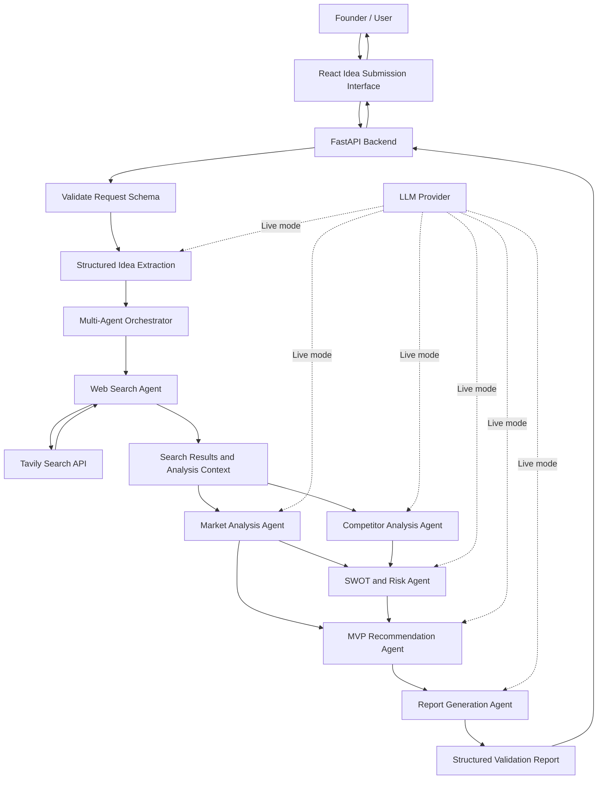
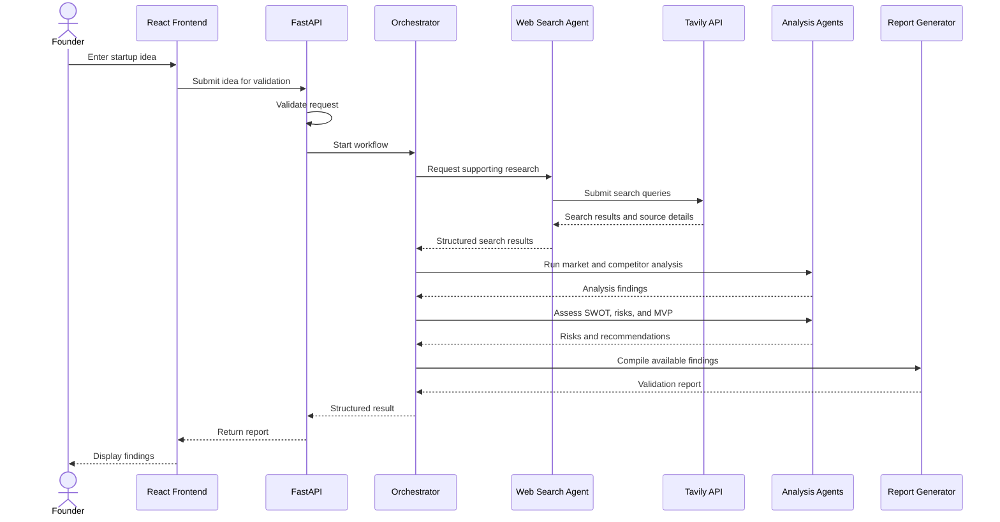

# AI-Based Startup Idea Validator

An AI-assisted application for exploring startup concepts through structured idea extraction, web research, multi-agent analysis, and a consolidated validation report.

The repository contains a React-based idea submission interface alongside Python prototypes for idea extraction, web search, multi-agent orchestration, and integration testing.

## Contents

- [Overview](#overview)
- [Core Capabilities](#core-capabilities)
- [System Architecture](#system-architecture)
- [Startup Validation Workflow](#startup-validation-workflow)
- [Technology Stack](#technology-stack)
- [Repository Structure](#repository-structure)
- [Getting Started](#getting-started)
- [Configuration](#configuration)
- [Testing](#testing)
- [Limitations](#limitations)
- [Security](#security)
- [Documentation](#documentation)

## Overview

Evaluating a startup concept requires understanding the problem, intended customers, market signals, competing solutions, execution risks, and the smallest useful product to test.

The AI-Based Startup Idea Validator is designed to organize this early evaluation process. It accepts a startup idea, gathers relevant web information where configured, coordinates analysis stages, and returns findings in a structured report. The report supports early decision-making; it is not a guarantee of commercial success or a substitute for customer research.

## Core Capabilities

- **Idea submission:** Collects startup details through a web interface.
- **Structured extraction:** Converts a free-text idea into structured fields for analysis.
- **Web research:** The standalone search agent integrates with Tavily to retrieve relevant pages, titles, URLs, snippets, and relevance scores.
- **Multi-agent orchestration:** Coordinates market analysis, competitor analysis, SWOT and risk assessment, MVP recommendations, and report generation.
- **API-based backend:** Uses FastAPI endpoints for the backend prototypes.
- **Mock mode:** The Task 4 prototype supports workflow testing without live API credentials.
- **Report output:** Organizes analysis into a validation report with source links where available.

The repository contains separate task implementations and prototypes. Their integration and configuration may vary; the diagrams below describe the intended workflow and the documented Task 4 orchestration.

## System Architecture

This Mermaid flowchart shows the main components and their data flow.



### Architecture notes

1. The user submits a startup idea through the interface.
2. The backend validates the request and prepares structured idea data.
3. The orchestrator coordinates the configured analysis stages.
4. The Web Search Agent can retrieve online evidence through Tavily.
5. Market and competitor analysis use the idea and available research context.
6. SWOT/risk and MVP recommendation stages use the preceding analysis outputs.
7. The report-generation stage assembles the findings and returns the result through the API.

The LLM and web-search integrations depend on module configuration and valid credentials. Mock results are illustrative rather than verified market research.

## Startup Validation Workflow

The following sequence diagram focuses on the request lifecycle from submission through report generation.



This sequence represents the intended workflow documented for the project. Exact execution behavior depends on the selected task implementation and whether mock or live mode is enabled.

## Technology Stack

| Area | Technologies |
|---|---|
| Frontend | React, React Router, Vite, JavaScript, HTML, CSS |
| Backend APIs | Python, FastAPI, Uvicorn |
| Data validation | Pydantic |
| LLM integration | OpenAI-compatible LLM client in the Task 4 prototype |
| Web research | Tavily Search API |
| Configuration | `python-dotenv` |
| Testing | Pytest, HTTPX |

Check each task's `requirements.txt` and README for its exact dependencies.

## Repository Structure

```text
.
├── System_Architecture.md
├── index.html
├── Task-1-Initial Idea-Submission-Interface/
│   ├── src/
│   ├── docs/
│   ├── package.json
│   └── README.md
├── Task 2 - Extraction using LLM/
│   ├── idea_extractor.py
│   ├── models.py
│   └── view_sample_pipeline.py
├── Task-3-Web-Searching-Agent/
│   ├── web_search_agent.py
│   ├── main.py
│   ├── requirements.txt
│   └── README.md
├── Task-4-Multi-Agents-Architecture/
│   ├── app/
│   ├── docs/
│   │   ├── architecture.md
│   │   └── orchestration-flow.md
│   ├── requirements.txt
│   └── README.md
└── Task 5 - Integration and Testing/
    ├── agents.py
    ├── idea_extraction.py
    ├── orchestrator.py
    ├── main.py
    ├── schemas.py
    ├── web_search.py
    ├── requirements.txt
    └── test_*.py
```

Folder names are shown as they appear in this repository.

## Getting Started

### Prerequisites

- Python 3.10 or a compatible version supported by the selected dependencies
- Node.js and npm
- Git
- Internet access for installing packages and using live web search
- API credentials for live LLM and Tavily requests, where required

### 1. Run the frontend

From the repository root:

```bash
cd "Task-1-Initial Idea-Submission-Interface"
npm install
npm run dev
```

Open the local URL printed by Vite, commonly `http://localhost:5173`.

To create a production build:

```bash
npm run build
```

### 2. Run the Task 4 multi-agent backend

From the repository root:

```powershell
cd "Task-4-Multi-Agents-Architecture"
python -m venv .venv
.\.venv\Scripts\Activate.ps1
python -m pip install -r requirements.txt
python -m uvicorn app.main:app --reload
```

On macOS/Linux, activate the environment with:

```bash
source .venv/bin/activate
```

Open `http://127.0.0.1:8000/docs` to inspect the available API endpoints.

### 3. Run the standalone web search agent

From the repository root, install its dependencies:

```bash
python -m pip install -r "Task-3-Web-Searching-Agent/requirements.txt"
```

Create a local `.env` file inside `Task-3-Web-Searching-Agent` using `.env.example` as a guide. Add your own Tavily API key, then start the API:

```bash
python -m uvicorn --app-dir Task-3-Web-Searching-Agent main:app --reload --port 8001
```

Open `http://127.0.0.1:8001/docs` to explore the endpoints. The task documentation identifies `POST /api/web-search` as the search endpoint.

### 4. Run the integration and testing module

From the repository root:

```powershell
cd "Task 5 - Integration and Testing"
python -m venv .venv
.\.venv\Scripts\Activate.ps1
python -m pip install -r requirements.txt
pytest
```

Review the individual tests before running them: some integration checks may require internet access or configured credentials.

## Configuration

For a module that uses environment variables:

1. Open that module's `.env.example`.
2. Create a local `.env` file in the same directory.
3. Add valid credentials only for the services you intend to use.
4. Keep mock mode enabled for initial testing where supported.
5. Never commit `.env` files or real credentials.

Common configuration fields in the backend prototypes may include:

```dotenv
USE_MOCKS=true
LLM_API_KEY=
LLM_BASE_URL=
LLM_MODEL=
TAVILY_API_KEY=
```

Only use the variables required by the module being run. The LLM base URL and model depend on the provider. Set mock mode to `false` only after configuring the relevant live-service credentials.

## Testing

The Task 5 directory contains test files for milestone and Tavily connection checks. From that directory, run:

```bash
pytest
```

Tests that make external requests may fail when credentials are absent, network access is unavailable, or the external service is unavailable. Check each test's requirements before interpreting a failure.

## Limitations

- Web results can be incomplete, outdated, or indirectly relevant.
- AI-generated analysis can contain factual errors and should be checked against its sources.
- Mock-mode output is illustrative and must not be represented as verified market research.
- The system does not guarantee customer demand, profitability, market size, or commercial success.
- The repository includes separate task implementations and prototypes; a complete end-to-end integration may require additional configuration and verification.

## Security

- Never commit API keys, passwords, tokens, or private `.env` files.
- Keep `.env.example` limited to placeholders and non-sensitive defaults.
- If a real credential has been exposed in a repository or shared archive, revoke or rotate it.
- Treat external search content and AI-generated recommendations as unverified until reviewed.

## Documentation

- [System Architecture](System_Architecture.md)
- [Task 1: Idea Submission Interface](Task-1-Initial%20Idea-Submission-Interface/README.md)
- [Task 3: Web Search Agent](Task-3-Web-Searching-Agent/README.md)
- [Task 4: Multi-Agent Architecture](Task-4-Multi-Agents-Architecture/README.md)
- [Task 4: Detailed Architecture](Task-4-Multi-Agents-Architecture/docs/architecture.md)
- [Task 4: Orchestration Flow](Task-4-Multi-Agents-Architecture/docs/orchestration-flow.md)
# pytest cache directory #

This directory contains data from the pytest's cache plugin,
which provides the `--lf` and `--ff` options, as well as the `cache` fixture.

**Do not** commit this to version control.

See [the docs](https://docs.pytest.org/en/stable/how-to/cache.html) for more information.
